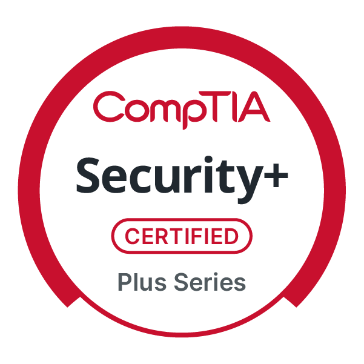

# Josh Talley

**SOC Analyst | Detection Engineering (CDEA) | Python**

## Certifications

- **Certified Detection Engineering Associate (CDEA)**, Centri (November 2026)
- **CompTIA Security+** (October 2025)
- **TryHackMe Pre-Security** (March 2025)
- **PCEP** - Certified Entry-Level Python Programmer (July 2023)

 

## Now

- SOC analyst in a 24/7 MDR environment, CDEA and Security+ certified
- Earned the CDEA from Centri (formerly Security Blue Team) in November 2026, on a 24-hour practical detection engineering exam
- Rebuilding the homelab on Proxmox VE; the ELK SIEM restores from captured index templates, pipelines, and saved objects
- Next up: detection engineering projects built on the CDEA coursework

## Featured Project

### [Sigma Studio v2.0 + ELK SIEM](https://github.com/josh-talley/sigma-studio-elk)
Independent Security Lab, 2025 to 2026. Detection engineering platform built on a homelab ELK SIEM (v2.0, March 2026):
- **30 custom Sigma rules** deployed across 2 SIEMs (Elastic and Splunk), with 3 additional conversion backends
- **5 backends, 7 query languages** (Lucene, ES|QL, EQL, SPL, KQL, YARA-L, LogScale QL)
- Full lifecycle CLI: Discover, Convert, Deploy, Tune
- 28 MITRE ATT&CK techniques across 10 tactics
- Diagnosed an IPv6 parsing gap that was silently dropping 28% of firewall events from detection coverage
- Correlation rules, overlay tuning, client-scoped configuration
- [Case study](https://github.com/josh-talley/sigma-studio-elk/tree/main/correlation-case-study): a false-negative gap in pySigma's Elasticsearch correlation backend, validated with controlled A/B testing

**Skills demonstrated:** Detection engineering, multi-SIEM architecture, Python automation, pySigma pipelines, API integration, data engineering

## Tech Stack
- **OS**: Linux | Mac | Windows
- **Languages:** Python | SQL | Bash
- **Security:** ELK Stack | Splunk | Sigma / pySigma | MITRE ATT&CK | Detection Engineering
- **Data:** PostgreSQL | DuckDB | pandas | SQLAlchemy
- **APIs:** Kibana Detection Engine | Splunk REST API
- **Tools:** Git | Docker | Proxmox VE | Tailscale | Azure

## Connect
- **Email:** josh@joshtalley.com
- **LinkedIn:** [linkedin.com/in/josh-talley](https://linkedin.com/in/josh-talley)

---
